# CareFlow System - UML Class Diagram & Design Pattern Architecture
**Course:** CSE 3206 Software Engineering Sessional | **Department of CSE, RUET**  
**Author:** Md. Rofaz Hasan Rafiu (22 Series)

---

## 1. Complete UML Class Diagram

The following Mermaid diagram visualizes the primary domain models, design patterns, services, and repository layers in CareFlow.

```mermaid
classDiagram
    %% Core Domain Entities
    class User {
        +string user_id
        +string name
        +string email
        +UserRole role
        +string password_hash
        +string phone
        +string created_at
        +hash_password(string) string
        +verify_password(string) bool
        +to_dict() dict
    }

    class Appointment {
        +string appointment_id
        +string patient_id
        +string doctor_id
        +string scheduled_time
        +string reason
        +float fee
        +AppointmentStatus status
        +confirm() void
        +complete() void
        +cancel() void
        +to_dict() dict
    }

    class Invoice {
        +string invoice_id
        +string appointment_id
        +string patient_id
        +float base_amount
        +float discount_amount
        +float tax_amount
        +PaymentStatus status
        +string payment_reference
        +float total_payable
        +mark_as_paid(string) void
        +to_dict() dict
    }

    class MedicalRecord {
        +string record_id
        +string appointment_id
        +string patient_id
        +string doctor_id
        +string diagnosis
        +string notes
        +List~PrescriptionItem~ prescriptions
        +add_prescription(PrescriptionItem) void
        +to_dict() dict
    }

    %% Creational Pattern: Singleton
    class DatabaseManager {
        -_instance DatabaseManager
        -_lock Lock
        +db_path string
        +get_connection() Connection
        +init_schema() void
        +close() void
        +reset_instance() void
    }

    %% Creational Pattern: Factory Method
    class INotificationChannel {
        <<interface>>
        +send(recipient, subject, message) dict
    }
    class EmailNotificationChannel {
        +string smtp_host
        +send(recipient, subject, message) dict
    }
    class SMSNotificationChannel {
        +string sms_api_key
        +send(recipient, subject, message) dict
    }
    class WebhookNotificationChannel {
        +string endpoint_url
        +send(recipient, subject, message) dict
    }
    class NotificationFactory {
        -_registry dict
        +register_channel(type, cls) void
        +create_channel(type, kwargs) INotificationChannel
    }
    INotificationChannel <|.. EmailNotificationChannel
    INotificationChannel <|.. SMSNotificationChannel
    INotificationChannel <|.. WebhookNotificationChannel
    NotificationFactory ..> INotificationChannel : creates

    %% Structural Pattern: Adapter
    class IPaymentProcessor {
        <<interface>>
        +process_payment(amount, reference_id, customer_info) PaymentResult
    }
    class BkashGateway {
        +string merchant_wallet
        +execute_bKash_payment(msisdn, bdt_amount, token) dict
    }
    class StripeGateway {
        +string api_key
        +charge_customer_cents(amount_cents, currency, email, idem_key) dict
    }
    class BkashPaymentAdapter {
        -BkashGateway gateway
        -string app_token
        +process_payment(amount, reference_id, customer_info) PaymentResult
    }
    class StripePaymentAdapter {
        -StripeGateway gateway
        +process_payment(amount, reference_id, customer_info) PaymentResult
    }
    IPaymentProcessor <|.. BkashPaymentAdapter
    IPaymentProcessor <|.. StripePaymentAdapter
    BkashPaymentAdapter --> BkashGateway : adapts
    StripePaymentAdapter --> StripeGateway : adapts

    %% Behavioral Pattern: Observer
    class IAppointmentObserver {
        <<interface>>
        +update(event_type, appointment, metadata) void
    }
    class AppointmentSubject {
        -_observers List~IAppointmentObserver~
        +attach(observer) void
        +detach(observer) void
        +notify(event_type, appointment, metadata) void
    }
    class EmailNotificationObserver {
        +sent_emails List
        +update(event_type, appointment, metadata) void
    }
    class SMSNotificationObserver {
        +sent_sms List
        +update(event_type, appointment, metadata) void
    }
    class AuditLogObserver {
        -DatabaseManager db
        +update(event_type, appointment, metadata) void
    }
    IAppointmentObserver <|.. EmailNotificationObserver
    IAppointmentObserver <|.. SMSNotificationObserver
    IAppointmentObserver <|.. AuditLogObserver
    AppointmentSubject o--> IAppointmentObserver : notifies

    %% Behavioral Pattern: Strategy
    class IBillingStrategy {
        <<interface>>
        +compute(base_amount) BillingCalculationResult
    }
    class StandardBillingStrategy {
        +compute(base_amount) BillingCalculationResult
    }
    class StudentDiscountStrategy {
        +compute(base_amount) BillingCalculationResult
    }
    class InsuranceCoverageStrategy {
        +compute(base_amount) BillingCalculationResult
    }
    class EmergencyCareStrategy {
        +compute(base_amount) BillingCalculationResult
    }
    IBillingStrategy <|.. StandardBillingStrategy
    IBillingStrategy <|.. StudentDiscountStrategy
    IBillingStrategy <|.. InsuranceCoverageStrategy
    IBillingStrategy <|.. EmergencyCareStrategy

    %% Service Orchestration
    class AppointmentService {
        -AppointmentRepository appointment_repo
        -UserRepository user_repo
        -AppointmentSubject subject
        +book_appointment(...) Appointment
        +confirm_appointment(...) Appointment
        +cancel_appointment(...) Appointment
    }
    class BillingService {
        -BillingRepository billing_repo
        -AppointmentRepository appointment_repo
        -IPaymentProcessor payment_processor
        +generate_invoice(appt_id, strategy, promo, notes) Invoice
        +process_invoice_payment(...) PaymentResult
    }

    AppointmentService --> AppointmentSubject : triggers
    AppointmentService --> Appointment : manages
    BillingService --> IBillingStrategy : calculates fee via
    BillingService --> IPaymentProcessor : executes charge via
    BillingService --> Invoice : manages
    AuditLogObserver --> DatabaseManager : persists audit log
```

---

## 2. Design Patterns Evaluation Matrix

The project incorporates **5 patterns** across **Creational, Structural, and Behavioral** categories, significantly exceeding the syllabus baseline requirement of at least 3 patterns from 2 categories.

| Pattern | Category | Problem Solved in CareFlow | Rejected Alternative & Technical Reason |
| :--- | :--- | :--- | :--- |
| **Singleton** | Creational | Prevents multiple competing uncoordinated SQLite database connection handles across multi-threaded request contexts, eliminating file-lock corruption and redundant memory overhead. | **Global Module Connection Variable**: Lacks thread-safe double-checked synchronization, pollutes global scope, and prevents cleanly resetting the DB state between independent unit test runs. |
| **Factory Method** | Creational | Decouples business logic from concrete communication channels (Email, SMS, Webhook), enabling runtime channel registration without modifying appointment code. | **Hardcoded Conditionals (`if-elif-else`)**: Violates Open-Closed Principle (OCP). Adding a new channel like WhatsApp requires editing core business methods, increasing regression risk. |
| **Adapter** | Structural | Converts radically different third-party payment gateway interfaces (`BkashGateway` requiring BDT floats and phone strings vs. `StripeGateway` requiring integer cents and idempotency keys) into a single, unified `IPaymentProcessor` target interface. | **Direct Vendor Invocations in BillingService**: Severely couples clinic billing to third-party SDK parameters. Any vendor API update would force refactoring of internal invoice records and break unit testing. |
| **Observer** | Behavioral | Decouples appointment lifecycle transitions (`BOOKED`, `CONFIRMED`, `CANCELLED`) from auxiliary side-effects (patient email, SMS alert, persistent SQLite audit logging), ensuring Single Responsibility Principle (SRP). | **Direct Method Calls inside Service Methods**: Chaining `send_email()`, `send_sms()`, and `insert_audit()` directly inside `book_appointment()` creates high coupling; failure in email dispatch would crash core booking. |
| **Strategy** | Behavioral | Encapsulates divergent healthcare pricing rules (General 5% VAT, RUET Student 30% waiver, Insurance 80% co-pay, Emergency 25% surcharge) into interchangeable strategy objects selected dynamically at runtime. | **Nested Switch/If Statements in `calculate_total()`**: Violates OCP and leads to high cyclomatic complexity. Adding a Senior Citizen discount would require altering existing battle-tested billing logic. |

