# CareFlow System - Comprehensive UML Class & Architecture Diagram
**Course:** CSE 3206 Software Engineering Sessional | **Department of CSE, RUET**  
**Author:** Md. Rofaz Hasan Rafiu (22 Series)

---

## 1. Visual Architecture Diagram
The high-resolution visual UML diagram is available at:  
👉 **[`careflow_uml_diagram.png`](careflow_uml_diagram.png)** (and embedded inside the formal PDF project report).

---

## 2. Mermaid Structural Class Diagram

```mermaid
classDiagram
    %% ==========================================
    %% 1. Domain Entities
    %% ==========================================
    class User {
        +string user_id
        +string name
        +string email
        +string role
        +string password_hash
        +string phone
        +string created_at
        +hash_password(string) string
        +verify_password(string) bool
        +to_dict() dict
    }

    class Appointment {
        +string appointment_id
        +string patient_id
        +string doctor_id
        +string scheduled_time
        +string reason
        +float fee
        +string status
        +string created_at
        +confirm() void
        +complete() void
        +cancel() void
        +to_dict() dict
    }

    class Invoice {
        +string invoice_id
        +string appointment_id
        +string patient_id
        +float base_amount
        +float discount_amount
        +float tax_amount
        +string status
        +string payment_reference
        +float total_payable
        +mark_as_paid(string) void
        +to_dict() dict
    }

    class PrescriptionItem {
        +string medicine_name
        +string dosage
        +string frequency
        +int duration_days
        +to_dict() dict
    }

    class MedicalRecord {
        +string record_id
        +string appointment_id
        +string patient_id
        +string doctor_id
        +string diagnosis
        +string notes
        +List~PrescriptionItem~ prescriptions
        +add_prescription(PrescriptionItem) void
        +to_dict() dict
    }

    MedicalRecord *-- PrescriptionItem : contains
    User "1" --> "0..*" Appointment : books/manages
    Appointment "1" --> "1" Invoice : generates
    Appointment "1" --> "0..1" MedicalRecord : results in

    %% ==========================================
    %% 2. Creational Patterns
    %% ==========================================
    class DatabaseManager {
        <<Singleton>>
        -_instance DatabaseManager
        -_lock Lock
        +string db_name
        +Connection connection
        +get_connection() Connection
        +init_database() void
        +close() void
        +reset_instance() void
    }

    class INotificationChannel {
        <<Interface>>
        +send(recipient, subject, message) dict
    }
    class EmailNotificationChannel {
        +send(recipient, subject, message) dict
    }
    class SMSNotificationChannel {
        +send(recipient, subject, message) dict
    }
    class WebhookNotificationChannel {
        +send(recipient, subject, message) dict
    }
    class NotificationFactory {
        <<Factory Method>>
        -_channels dict
        +create_channel(string) INotificationChannel
        +register_channel(string, class) void
    }
    INotificationChannel <|.. EmailNotificationChannel
    INotificationChannel <|.. SMSNotificationChannel
    INotificationChannel <|.. WebhookNotificationChannel
    NotificationFactory ..> INotificationChannel : creates

    %% ==========================================
    %% 3. Structural Pattern: Adapter
    %% ==========================================
    class IPaymentProcessor {
        <<Interface>>
        +process_payment(amount, reference_id, customer_info) PaymentResult
    }
    class BkashGateway {
        +execute_bKash_payment(msisdn, bdt_amount, token) dict
    }
    class StripeGateway {
        +charge_customer_cents(cents, currency, email, idem_key) dict
    }
    class BkashPaymentAdapter {
        -BkashGateway gateway
        -string app_token
        +process_payment(amount, reference_id, customer_info) PaymentResult
    }
    class StripePaymentAdapter {
        -StripeGateway gateway
        +process_payment(amount, reference_id, customer_info) PaymentResult
    }
    IPaymentProcessor <|.. BkashPaymentAdapter
    IPaymentProcessor <|.. StripePaymentAdapter
    BkashPaymentAdapter --> BkashGateway : wraps
    StripePaymentAdapter --> StripeGateway : wraps

    %% ==========================================
    %% 4. Behavioral Pattern: Observer
    %% ==========================================
    class IAppointmentObserver {
        <<Interface>>
        +update(event_type, appointment, metadata) void
    }
    class AppointmentSubject {
        -_observers List
        +attach(observer) void
        +detach(observer) void
        +notify(event_type, appointment, metadata) void
    }
    class EmailNotificationObserver {
        +update(event_type, appointment, metadata) void
    }
    class SMSNotificationObserver {
        +update(event_type, appointment, metadata) void
    }
    class AuditLogObserver {
        -DatabaseManager db
        +update(event_type, appointment, metadata) void
    }
    IAppointmentObserver <|.. EmailNotificationObserver
    IAppointmentObserver <|.. SMSNotificationObserver
    IAppointmentObserver <|.. AuditLogObserver
    AppointmentSubject o--> IAppointmentObserver : notifies

    %% ==========================================
    %% 5. Behavioral Pattern: Strategy
    %% ==========================================
    class IBillingStrategy {
        <<Interface>>
        +compute(base_amount) BillingCalculationResult
    }
    class StandardBillingStrategy {
        +compute(base_amount) BillingCalculationResult
    }
    class StudentDiscountStrategy {
        +compute(base_amount) BillingCalculationResult
    }
    class InsuranceCoverageStrategy {
        +compute(base_amount) BillingCalculationResult
    }
    class EmergencyCareStrategy {
        +compute(base_amount) BillingCalculationResult
    }
    IBillingStrategy <|.. StandardBillingStrategy
    IBillingStrategy <|.. StudentDiscountStrategy
    IBillingStrategy <|.. InsuranceCoverageStrategy
    IBillingStrategy <|.. EmergencyCareStrategy

    %% ==========================================
    %% 6. Service & Repository Coordination
    %% ==========================================
    class AppointmentService {
        -AppointmentRepository appt_repo
        -UserRepository user_repo
        -AppointmentSubject subject
        +book_appointment(...) Appointment
        +confirm_appointment(...) Appointment
        +cancel_appointment(...) Appointment
    }
    class BillingService {
        -BillingRepository billing_repo
        -AppointmentRepository appt_repo
        -IPaymentProcessor payment_processor
        +generate_invoice(...) Invoice
        +process_invoice_payment(...) PaymentResult
    }

    AppointmentService --> AppointmentRepository : queries
    AppointmentService --> AppointmentSubject : triggers
    BillingService --> BillingRepository : queries
    BillingService --> IBillingStrategy : calculates via
    BillingService --> IPaymentProcessor : executes via
    AuditLogObserver --> DatabaseManager : records to audit_logs
```

---

## 3. Detailed Architectural Breakdown

### 3.1 Tier 1: Domain Entities
- **`User`**: Manages personal profile data and secure credential verification using salted SHA-256 (`hash_password()`). Supports multiple roles (`PATIENT`, `DOCTOR`, `ADMIN`, `RECEPTIONIST`).
- **`Appointment`**: Serves as the Aggregate Root for consultation requests. Implements state transition validation (`PENDING` → `CONFIRMED` → `COMPLETED` / `CANCELLED`), preventing illegal state mutations.
- **`Invoice`**: Handles consultation billing records. Features a dynamic property `total_payable = base - discount + tax`.
- **`MedicalRecord` & `PrescriptionItem`**: Captures doctor diagnostic notes and structured medication prescriptions.

### 3.2 Tier 2: Data Access Layer (Repositories)
- **`DatabaseManager` (Singleton Pattern)**: Manages SQLite connection pooling with thread-safe `__new__` mutex locks, preventing database lock collisions.
- **`AppointmentRepository`**: Implements slot collision checking via `is_doctor_slot_occupied()` to reject double-booking conflicts.
- **`UserRepository`, `BillingRepository`, `MedicalRecordRepository`**: Encapsulate clean CRUD operations, decoupling raw SQL from business logic.

### 3.3 Tier 3: Business Service Layer
- **`AppointmentService`**: Orchestrates doctor availability validation and broadcasts state changes to `AppointmentSubject`.
- **`BillingService`**: Injects `IBillingStrategy` to apply discounts (Standard, RUET Student 30%, Insurance 80%, Emergency) and calls `IPaymentProcessor` to settle charges.
- **`AuthService`**: Enforces email uniqueness, role assignment, and JWT authentication.
- **`MedicalRecordService`**: Links diagnoses to appointments, marking confirmed appointments as `COMPLETED`.

### 3.4 Tier 4: Gang of Four Design Patterns
1. **Singleton (Creational)**: `DatabaseManager` ensures a single shared database connection pool across all threads.
2. **Factory Method (Creational)**: `NotificationFactory` constructs channel objects (`Email`, `SMS`, `Webhook`) based on string identifiers, enabling runtime registration of new channels.
3. **Adapter (Structural)**: `BkashPaymentAdapter` and `StripePaymentAdapter` adapt incompatible third-party payment APIs into the clinic's unified `IPaymentProcessor`.
4. **Observer (Behavioral)**: `AppointmentSubject` notifies registered observers (`EmailNotificationObserver`, `SMSNotificationObserver`, `AuditLogObserver`) without coupling the appointment booking code to communication or auditing details.
5. **Strategy (Behavioral)**: `IBillingStrategy` encapsulates dynamic pricing algorithms, allowing runtime switching of healthcare subsidy policies without modifying the `Invoice` class.
